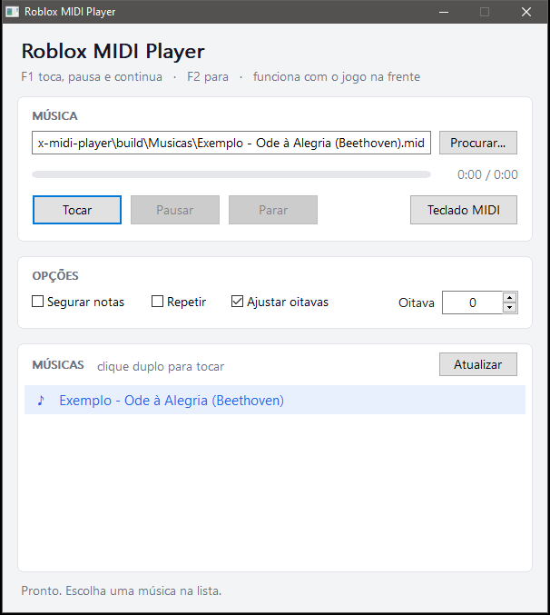

# Roblox MIDI Player

Toca arquivos `.mid` nos pianos do Roblox: o programa aperta as teclas do teclado por você, no ritmo da música.
Feito para os pianos com o layout do Virtual Piano (61 teclas, `1` até `m`), que é o da maioria dos pianos do Roblox.



*[English summary below](#english)*

## O que ele faz

- **Lista de músicas:** tudo que estiver na pasta `Musicas`, ao lado do programa, aparece na lista pelo nome.
  Um clique escolhe, clique duplo já toca.
- **F1 e F2 dentro do jogo:** F1 toca, pausa e continua; F2 para. Não precisa sair do Roblox.
- **Pausar e continuar** do mesmo ponto, com barra de progresso e tempo (`1:23 / 3:05`).
- **Segurar notas:** cada tecla fica apertada pelo tempo que a nota dura no arquivo. A música soa bem mais natural
  nos pianos que cortam o som quando a tecla é solta.
- **Sustenidos** (as teclas pretas) saem com Shift, do jeito que o piano do Roblox espera.
- **Ajustar oitavas:** nota grave ou aguda demais para o piano é trazida para dentro, em vez de sumir.

## Como usar

1. Baixe o `.zip` na página de [Releases](../../releases) e descompacte numa pasta.
2. Coloque seus arquivos `.mid` dentro da pasta `Musicas`. Já vem uma de exemplo, a Ode à Alegria.
3. Abra o `RobloxMidiPlayer.exe` e escolha a música na lista.
4. Entre no jogo, sente no piano e aperte **F1**. A música começa em meio segundo.
5. **F1** de novo pausa, mais um **F1** continua. **F2** para.

> Se o Windows mostrar "O Windows protegeu o computador", clique em **Mais informações** e depois em
> **Executar assim mesmo**. O aviso aparece com todo programa sem assinatura paga. O código está todo aqui
> e você pode compilar o seu (veja abaixo).

## Opções

| Opção | O que faz |
| --- | --- |
| **Segurar notas** | Aperta a tecla no início da nota e solta no fim. Desligada: cada nota é um toque rápido. |
| **Repetir** | Começa a música de novo quando ela acaba. |
| **Ajustar oitavas** | Notas fora do piano (abaixo de C2 ou acima de C7) mudam de oitava até caber. Vem ligada. |
| **Oitava** | Sobe ou desce a música inteira em oitavas, de -3 a +3. |
| **Teclado MIDI** | Toca no jogo o que você tocar num teclado MIDI ligado ao computador. |

## Dúvidas

**A câmera fica girando quando toca sustenido.** O Shift Lock do Roblox está ligado. Desligue nas configurações
do Roblox: o programa usa o Shift para as teclas pretas.

**Segurar notas não muda nada.** Esse piano toca a nota inteira só com o aperto. Nele, segurar e tocar soam igual.

**F1 ou F2 não funciona.** Outro programa já usa a tecla; a linha de baixo da janela avisa. Use os botões.

**Saem notas erradas.** Confira se o piano do jogo usa o layout do Virtual Piano (teclas brancas `1234567890qwertyuiopasdfghjklzxcvbnm`,
pretas com Shift). Pianos com outro layout não vão bater.

**Onde acho arquivos MIDI?** Sites como BitMidi e VGMusic têm muitos. Respeite os direitos de quem fez o arranjo.

## Mapa das teclas

As 36 teclas brancas vão de C2 (`1`) a C7 (`m`); o dó central (C4) é o `t`.
Cada tecla preta é Shift + a branca logo abaixo dela: C#2 é `!` (Shift+1), C#4 é `T` (Shift+t).

```
Brancas:  1 2 3 4 5 6 7 | 8 9 0 q w e r | t y u i o p a | s d f g h j k | l z x c v b n | m
Oitava:   C2            | C3            | C4            | C5            | C6            | C7
```

## Compilar você mesmo

Precisa do GCC 13 ou mais novo para Windows (MinGW-w64; por exemplo o
[WinLibs](https://winlibs.com/), que dá para instalar com `winget install BrechtSanders.WinLibs.POSIX.UCRT`).

```
build.bat
```

O programa sai em `build\RobloxMidiPlayer.exe`, já com a pasta `Musicas`.

## Créditos e licença

Baseado no [Heartopia-Midi-Player](https://github.com/DonElf/Heartopia-Midi-Player), de **Don_Elf**,
licença Apache 2.0. O leitor de arquivos MIDI e o envio de teclas vêm de lá.

Adaptação para o Roblox, novas funções e visual novo: **BlackWolf** (zzBlack_Wolf no Roblox).
A lista completa do que mudou está no começo de [`src/RobloxMidiPlayer.cpp`](src/RobloxMidiPlayer.cpp).

Licença Apache 2.0, a mesma do original: veja [`LICENSE`](LICENSE).

Este projeto não tem ligação com a Roblox Corporation. Use só em jogos que permitem tocar com programas assim.

---

## English

**Roblox MIDI Player** plays `.mid` files on Roblox pianos that use the Virtual Piano layout (61 keys, `1` to `m`),
by pressing the keys for you. Windows only.

- Put `.mid` files in the `Musicas` folder; they show up in the list. Click to pick, double-click to play.
- **F1** play / pause / resume, **F2** stop, both working from inside the game.
- Progress bar with time, pause and resume from the same spot.
- **Segurar notas** (hold notes) keeps each key down for the note's length, which sounds far more natural.
- Sharps are sent with Shift. **Ajustar oitavas** folds notes outside C2..C7 into range.

Download the `.zip` from [Releases](../../releases), or build with `build.bat` (GCC 13+, MinGW-w64).
Turn off Roblox's Shift Lock, or sharps will toggle the camera.

Based on [Heartopia-Midi-Player](https://github.com/DonElf/Heartopia-Midi-Player) by Don_Elf (Apache 2.0).
Not affiliated with Roblox Corporation.
